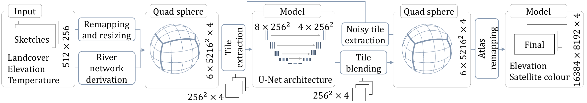
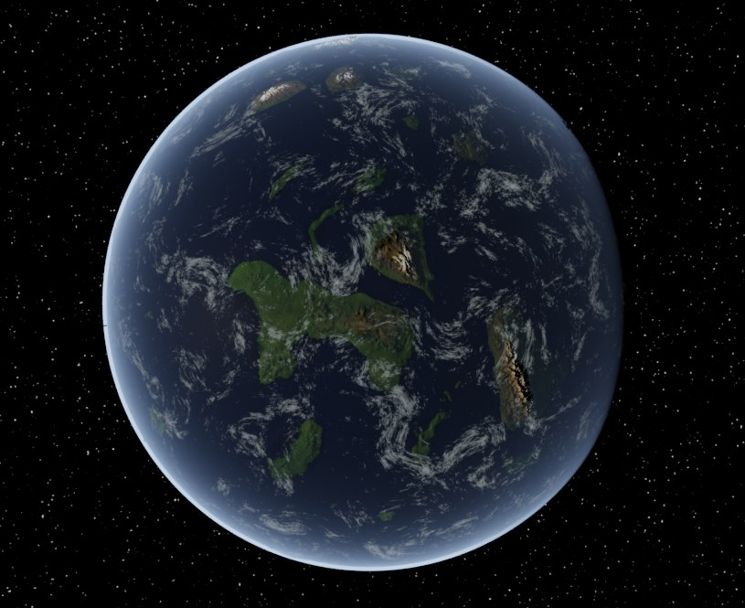
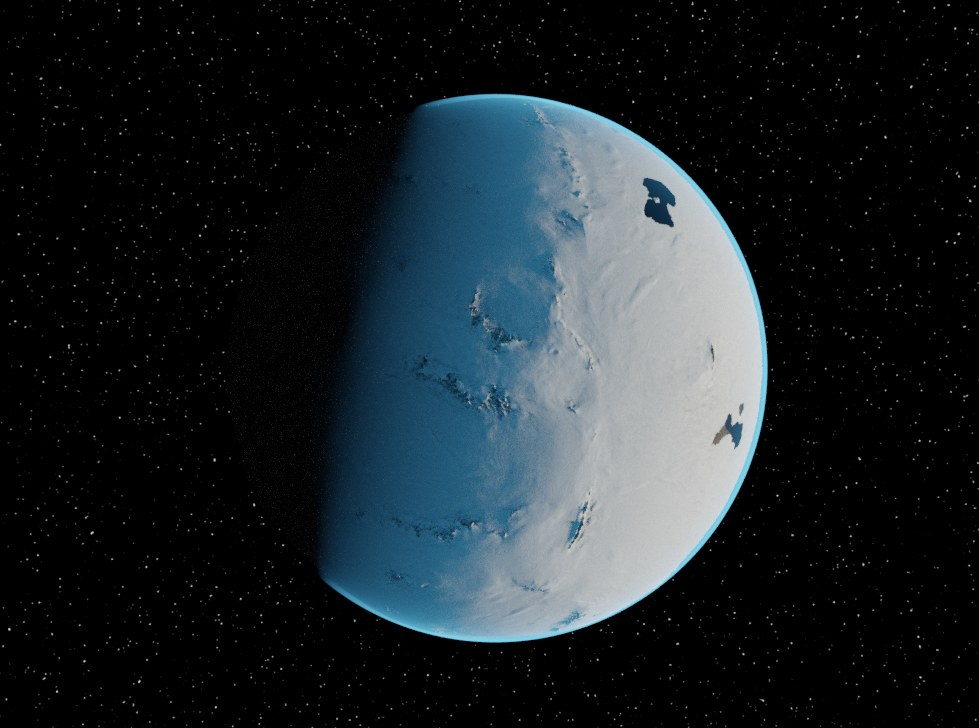
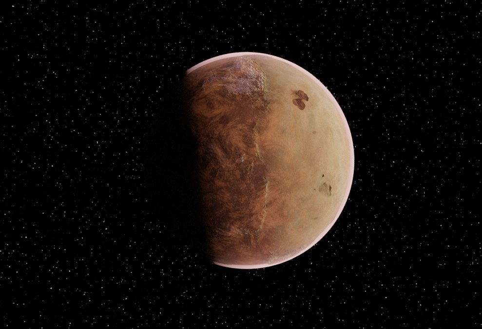
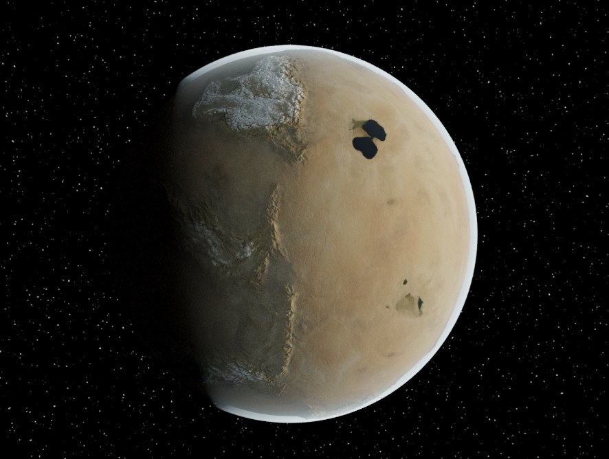

# Authoring Terrestrial Planets with Diffusion Models
http://doi.org/10.1111/cgf.70390

Forked from "Evaluating Diffusion Models for Terrain Generation".



Example planets generated from sketches:

| | |
|---|---|
|  |  |
|  |  |

## Setup

The environment is managed with conda (packages come from conda-forge). Linux with an NVIDIA GPU is the supported platform; Windows is experimental and macOS is not supported.

```sh
conda env create -f environment.yml
conda activate planet-diffusion
```

If conda is not installed, `./install.sh` installs Miniforge locally and creates the environment in `./.conda-env` (`install.ps1` on Windows).

conda-forge selects the PyTorch CUDA build that matches the installed NVIDIA driver, so no CUDA version needs to be chosen. On a machine without a visible GPU (for example a cluster login node) it would select the CPU build. Set the CUDA version explicitly in that case:
```sh
CONDA_OVERRIDE_CUDA=12.8 conda env create -f environment.yml
```

To check the installation:
```sh
python -c "import torch; print(torch.__version__, torch.cuda.is_available())"
```

## Pretrained weights

Weights are hosted at [huggingface.co/otrolie/PlanetDiffusion](https://huggingface.co/otrolie/PlanetDiffusion), one subfolder per model. They are downloaded automatically into `./models/<name>/final` the first time a model is used and the folder is missing. To download manually:
```sh
huggingface-cli download otrolie/PlanetDiffusion --include "PlanetDiffusion/final/*" --local-dir models
```
To publish a trained model, see `python -m src.misc.upload_weights --help`.

## GUI
With the environment activated, start the GUI:
```sh
python -m src.interface.view --data_dir ./planetAI/data --size 5 --downscale_offset 5 --diffusion_model_dir ./models/PlanetDiffusion
```
`size` is the size of the planet to generate. Size 5 has the same radius as Earth. Each step in size is a 2x increase in radius.
`downscale_offset` is the number of steps down to the sketch size. This is used to set the resolution of the sketch.
`diffusion_model_dir` is the directory containing the diffusion model to use.

## Training

To train run the following command: 
```sh
BATCH_SIZE=8 # This can stay as 8 on a 20GB partition. The script will automatically adjust it based on the tile size
NUM_EPOCHS=1000 # This will also be adapted based on the tile size
NUM_WORKERS=4
NUM_SAMPLES=$((BATCH_SIZE * 2))
python -m src.models.diffusion.train \
    --data_dir ./planetAI/data \
    --results_dir ./models \
    --samples_dir ./samples \
    --num_workers $NUM_WORKERS \
    --num_samples $NUM_SAMPLES \
    --auto_batch_size $BATCH_SIZE \
    --auto_num_epochs $NUM_EPOCHS \
    --tile_size 256 \
    --save_on_disk True \
    --experiment_name PlanetDiffusion \
    --image_mode planet \
    --river_upa_mode channel \
    --sketch_lod_levels 2 \
    --amp True \
    --use_controlnet False \
    --max_temp_variance 10
```

To see all available options run:
```sh
python -m src.models.diffusion.train --help
```

## Inference

You can run the following to generate tiles:
    
```sh
python -m src.models.diffusion.experiment_runner \
    --base_output_folder ./evaluation \
    --base_model_folder ./models \
    --num_images 10000 \
    --experiment_names "Old-tiles"
```

You can run the following to generate blended patches:

```sh
python -m src.models.diffusion.experiment_runner \
    --base_output_folder ./evaluation \
    --base_model_folder ./models \
    --num_images 625 \
    --experiment_names "Old-blended"
```

You can run the following to generate full planets:

```sh
python -m src.models.diffusion.experiment_runner \
    --base_output_folder ./evaluation \
    --base_model_folder ./models \
    --experiment_names "Old-real" \
    --real_sketch_names "ColdEquator" \
    --radius_power 0
```

## Evaluation

To evaluate tiles, run the following script:

```sh
output_types=("sat" "dem")
for ot in "${output_types[@]}"; do
    for ts in 250 100 50 25 10; do
        echo "Running experiment Timesteps ${ts}"
        python -m src.models.diffusion.evaluate \
            --eval_folder ./evaluation/Old-tiles_inference \
            --inference_args_filter timesteps:${ts} \
            --experiment_name "Ours tiles Timesteps ${ts}" \
            --output_type "${ot}"
    done
done
```

To evaluate blended patches, run the following script:
```sh
for ot in "${output_types[@]}"; do
    for rem in True False; do
        echo "Running experiment Timesteps ${ts}"
        python -m src.models.diffusion.evaluate \
            --eval_folder ./evaluation/Old-blended_inference\
            --inference_args_filter timesteps:100,use_rough_edge_mask:${rem} \
            --experiment_name "Ours blended Timesteps 100 Rough Edge ${rem}" \
            --output_type "${ot}" \
            --use_subfolders false \
            --max_images 3000
    done
done
```

## Docker

```sh
bash docker-build.sh   # builds the image from environment.yml (build arg CUDA_VERSION, default 12.8)
```
